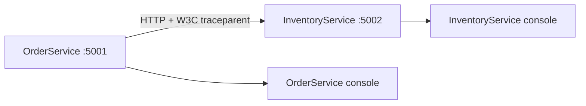

# OpenTelemetry .NET Demo (ASP.NET Core 10)

Verified sample for the article *OpenTelemetry in .NET: From Basic Logging to End-to-End Distributed Observability*.

Two services export traces, metrics and logs with `OpenTelemetry.Exporter.Console`. No Jaeger, Prometheus or Grafana is required.

Solution file: `OtelDotnetDemo.sln`

## Prerequisites

- [.NET 10 SDK](https://dotnet.microsoft.com/en-us/download/dotnet/10.0)

## Architecture



## Build

```bash
dotnet build OtelDotnetDemo.sln
```

## Test

```bash
dotnet test OtelDotnetDemo.sln
```

## Run

Terminal 1:

```bash
cd InventoryService
dotnet run
```

Terminal 2:

```bash
cd OrderService
dotnet run
```

## Verify

Successful order:

```bash
curl -s -X POST http://localhost:5001/api/orders \
  -H "Content-Type: application/json" \
  -d "{\"productId\": \"PROD-001\", \"quantity\": 5, \"customerId\": \"CUST-42\"}"
```

Insufficient stock:

```bash
curl -s -X POST http://localhost:5001/api/orders \
  -H "Content-Type: application/json" \
  -d "{\"productId\": \"PROD-003\", \"quantity\": 1, \"customerId\": \"CUST-07\"}"
```

In both service terminals, confirm that Activity output shares the same `TraceId` across OrderService and InventoryService, and that metric batches include `orders.created` / `inventory.stock.checks`.

## Ports

| Service           | URL                      |
|-------------------|--------------------------|
| OrderService      | http://localhost:5001    |
| InventoryService  | http://localhost:5002    |
